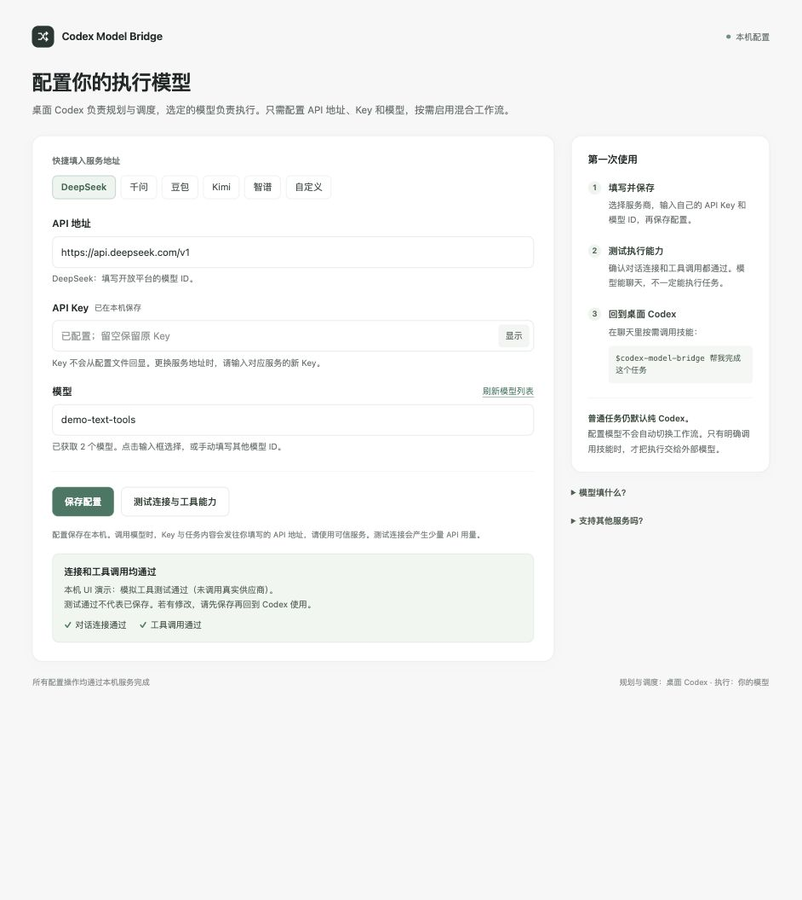

# Codex Model Bridge

**桌面 Codex 负责规划和最终决定，按需把执行、固定检查后的独立初审交给用户自己的模型 API。**

默认继续纯 Codex。用户明确调用 `$codex-model-bridge` 后，Codex 判断是否需要委派；简单问答仍直接回答。混合流程只保留省额档，不替换 Codex 默认模型，不修改 Codex 登录或模型配置。首版 macOS，MIT 开源。

## 下载和安装

从 [Releases](https://github.com/lrc839-tech/codex-model-bridge/releases/latest) 下载 `codex-model-bridge-v0.2.0-mac.zip`，也可把同一个 ZIP 发到微信群。

1. 解压 ZIP，运行 `install.command`。
2. 自动检查本机 Python 3.9+ 和桌面 Codex 的 CLI，复制完整 Skill 到 `~/.agents/skills/codex-model-bridge`。
3. 安装器打开本机配置页，填三个字段，测试后保存。
4. 在桌面 Codex 新聊天中输入 `$codex-model-bridge`，并描述任务。如果列表未刷新，重启桌面 Codex。

需要已安装桌面 Codex 和可用的 [Python 3](https://www.python.org/downloads/macos/)。本工具只用 Python 标准库，不需要 npm、pip、管理员权限或另外的 OpenAI API Key。首版不自动下载安装 Python；缺失时安装器给出提示。已在 Apple Silicon Mac 验证，Intel Mac 的实机安装尚未验证。Windows 尚不支持。

macOS 可能要求对下载的 `.command` 脚本“右键 → 打开”。也可在终端进入解压目录运行 `bash install.command`。首次安装保留终端窗口供本地设置页使用；服务空闲30分钟退出。后续随时运行 `configure.command` 重新打开。`uninstall.command` 只移除本工具安装的 Skill，保留个人配置与历史记录。升级会先备份旧 Skill。

**为什么先用 ZIP？** 这是 Skill 和本地辅助工具，ZIP 能直接检查源码、转发和标准安装。DMG 只是另一种封装，不会额外提供桌面应用能力；首版没有签名的独立原生 App。不要把源码 ZIP 的一键安装描述成零前置依赖。

## 三个字段在哪填

安装后自动打开 `127.0.0.1` 上的本机网页，也可以双击 `configure.command` 打开。

| 字段 | 填写内容 |
| --- | --- |
| API 链接 | 服务商提供的 **Chat Completions 兼容接口基础地址**；也接受完整 `/chat/completions` 地址 |
| API Key | 自己在对应服务商申请的 Key，以密码框输入 |
| 模型 | 可从接口拉取列表，也可以手动输入模型 ID；豆包也可能是 `ep-...` 推理接入点 |



页面预设 DeepSeek、千问、豆包、Kimi、智谱和自定义服务。预设只帮助填地址，不限制模型名字。换 API 地址后必须重新填 Key，避免把旧 Key 发给另一家服务。

| 供应商 | 基础地址示例 | 官方文档 |
| --- | --- | --- |
| DeepSeek | `https://api.deepseek.com/v1` | [接口与思考模式](https://api-docs.deepseek.com/guides/thinking_mode/) |
| 千问 | `https://dashscope.aliyuncs.com/compatible-mode/v1` | [Chat Completions](https://help.aliyun.com/zh/model-studio/qwen-api-via-openai-chat-completions) |
| 豆包 | `https://ark.cn-beijing.volces.com/api/v3` | [OpenAI 兼容接口](https://docs.volcengine.com/docs/ark/compatible-with-openai-sdk?lang=en) |
| Kimi | `https://api.moonshot.cn/v1` | [模型及参数](https://platform.kimi.com/docs/api/models-overview) |
| 智谱 | `https://open.bigmodel.cn/api/paas/v4` | [OpenAI 兼容接口](https://docs.bigmodel.cn/cn/guide/develop/openai/introduction) |

请以自己控制台提供的地址为准。千问可能使用工作空间、区域或套餐专用地址；豆包模型权限和接入点取决于账号。需要支持 **Chat Completions + 函数工具调用 + JSON 对象输出** 的文本模型。当前不向外部模型传图片、语音，也不提供浏览器或桌面插件；选择可识图模型也不会自动增加图像输入。未知模型不强加私有思考参数；部分新模型无法关闭思考，费用也会不同。

“测试连接”会验证实际工具调用往返，会使用你所选供应商的 API 额度。拉取模型列表失败或不支持，不等于手动模型一定不能用。一个品牌接入成功也不代表该品牌每个模型均兼容。

## 什么时候使用混合流程

- **纯 Codex**：正常使用桌面 Codex，不调用本 Skill。
- **混合省额流程**：输入 `$codex-model-bridge 本次用混合方式，帮我完成……`。对适合委派的低风险文件任务，桌面 Codex 制定范围和固定验收，外部模型实现，控制器运行检查，再用全新请求独立初审；自动修复最多两轮，然后交回桌面 Codex。
- **引用后仍由 Codex 完成**：`$codex-model-bridge 3+2等于几` 直接回答5，不为问答创建文件或调用外部 API。高风险、任务不划算、证据不足或无法可靠验收时也不委派。这里的任务路由依靠 Skill 规则与 Codex 判断；程序强制显式 `--mixed` 与文件合同，不是万能分类器。

混合档位只有一个，CLI 不再接受 `--mode`；旧 `--mode strict` 明确报错。调用示例是 `bridge.py run --mixed --task-file task.json`。

最终决定和整体工作流仍由桌面 Codex 负责。它需为每条重要验收标准记录 `pass / fail / unverified` 与对应证据，不能仅复述模型自称通过。只有它审阅后才将允许文件从副本集成回原项目；集成后重跑固定检查，保留原文件备份。检查失败、范围越界、证据变化、超时或初审不确定时，不自动宣称完成。验收仍可能遗漏缺陷，工具不能保证发现所有问题。

0.2.0 集成前还必须填写运行目录中的 `desktop-review.json`：由模板复制，保留合同与副本哈希，逐条记录通过证据，设置 `decision: accept`。只传 `--desktop-reviewed` 不足以集成；任一未通过、未验证、缺证据或哈希变化都会被拒绝。结构化报告不能保证验收判断无误。

初审有争议或缺证据时，Codex可先检查副本，在报告的 `external_review_resolution` 为每条问题记录裁决理由与新增证据。程序仅在本轮执行成功、固定检查通过、哈希一致且全部待验项已解决时允许集成；执行或检查失败不能被报告覆盖。这个异常处理属于同一省额流程，不增加档位。

例如生成“鹈鹕骑自行车的 HTML”：Codex 理解参考图、制定布局与动画要求；文本模型编写限定 HTML；固定检查覆盖可程序检查的结构和行为；Codex 打开页面，检查鹈鹕外形、脚踏关系、动画和交互。图像理解、视觉检查与桌面插件仍在 Codex 一侧，因此不要求外部模型具备识图能力；需要直接读图的局部任务目前由 Codex 自己完成。

验收不通过时，Codex 先明确哪条标准未满足以及实际证据，再区分合同/方案错误、实现错误、验收缺口、环境问题。分别修正任务描述、给出局部修复指令、补检查或排查环境，禁止原样反复重跑。两轮自动修复后，同一原始任务内桌面重新委派最多再两轮，使用 `--max-repairs 0` 不再重置自动修复预算，默认每轮不超过300秒并设剩余预算；连续两次无改善、风险扩大或预算用尽就停止委派，接手或报告未完成。这项桌面总限额由 Skill 规则约束，跨任务并非程序自动累计。

省额档旨在减少桌面 Codex 反复读工具日志、调试和初审的上下文。**没有固定省额比例保证**，拆任务、交接、最终审阅仍会使用 Codex 额度，外部服务独立计费。`model_stages` 计阶段，不是 API 请求数或费用上限。

## 任务用量与评测

外部模型每个请求立即写入 `usage-ledger.jsonl`，失败请求也保留。运行 summary 的 `external_usage` 区分实际请求数、输入、缓存输入、输出、推理子项。缺 usage 或中断的请求为 `unknown`，不记为零；已确认部分另列 `known_totals`。缓存输入已包含在输入内，推理已包含在输出内。

桌面 Codex 的会话记录可提供 Token 观测；独立 CLI 运行也能输出 `turn.completed.usage`。这些记录不等于 Pro 周额度的计费权重。完整任务须包含规划、执行、交接、验收及最终回答，且子代理单独计入；在任务中间采样会漏掉后续开销。周百分比仅作账号级辅助记录。

**首次真实小试验没有证明省额。** 同一题纯组91秒通过，混合组157秒因初审/交付故障未交付，Codex记录Token约两倍；Harness超时且尾账缺失，因此停止在3/18次。两份混合未交付代码事后均通过官方测试，这与正式交付成功不同。新修复尚未重新付费跑分。[查看完整结果与限制](docs/pilot-2026-10-25.md)。

开发者可从 GitHub 克隆后使用 [评测协议](https://github.com/lrc839-tech/codex-model-bridge/blob/main/benchmarks/protocol.md)、[隔离运行器](https://github.com/lrc839-tech/codex-model-bridge/blob/main/benchmarks/runner/README.md) 和固定版本的 Exercism 任务。公开小题可能存在训练数据污染，不能据此宣称一般智能领先。CLI 受控试验与桌面产品实测分开标注；操作系统隔离探针、候选工具审计都通过后才允许付费运行。普通分享 ZIP 不包含评测用运行时、API 配置或私人结果。

## 数据和执行边界

配置只在 `~/Library/Application Support/CodexModelBridge/profile.json`，文件权限600、目录700，不放进 Skill、项目、GitHub 或分享 ZIP。设置页不回显已保存的 Key，不使用浏览器持久存储，只绑定本机回环地址，校验 Host、会话和 CSRF。Key 会作为认证头发送给你填写的 API 地址；远程地址必须 HTTPS，拒绝重定向。

桌面 Codex 选入合同的文件内容会发送到该 API。安装本工具不代表所有项目都适合外发，请只选必要文件。外部模型可用的工具仅有选定文件的读写与隔离命令；终端命令不带 API Key，必须通过 Codex CLI macOS 沙箱，命令无网络权限。沙箱不可用就失败，不退回裸终端。

首版只支持小型 UTF-8 文件任务：最多64文件，单个2MiB、总计16MiB。依赖完整大型构建环境、二进制、任意目录复制、删除文件、生产操作和自动发布不在执行范围。本工具不是远程代理服务，也没有自动切换供应商或无限重试。

## 标准 Skill / 插件安装

仓库中的 `skills/codex-model-bridge` 是完整、自包含的 Skill，可以整体复制到自己的 Skills 目录，或用 Codex 的 skill-installer 从此 GitHub 路径安装。不要只复制 SKILL.md。首次运行配置命令设置自己的三字段。

也提供标准插件清单和 marketplace，可在支持以下命令的新版 Codex CLI 中使用：

```sh
codex plugin marketplace add lrc839-tech/codex-model-bridge
codex plugin add codex-model-bridge@codex-model-bridge
```

通过标准 Skill 或插件管理器安装时，直接在桌面 Codex 调用本 Skill 打开配置，卸载也用对应管理器；ZIP 的 configure/uninstall 入口针对本安装器的记录。

选择 ZIP、手动 Skill 或插件其中一种即可，避免重复出现同名 Skill。插件元数据遵循 [官方格式](https://developers.openai.com/plugins/build/plugins)。不同桌面版本的插件入口可能不同；当前首版以 Mac ZIP 安装方式验收。

## 开发与验证

```sh
PYTHONPATH=skills/codex-model-bridge python3 -m unittest discover -s tests -v
python3 scripts/build_release.py
python3 examples/prepare_demo.py
python3 skills/codex-model-bridge/scripts/bridge.py status
python3 skills/codex-model-bridge/scripts/bridge.py configure
```

`prepare_demo.py` 只创建一次性演示工作区和8项固定测试，不调用 API。由桌面 Codex 检查合同后，才执行 `bridge.py run --mixed --task-file <生成的task.json>`。运行记录在本机配置目录的 `runs`，不会随发布包分发。

发布包采用文件白名单、个人绝对路径和疑似 Key 检查，生成可复现 ZIP、`SHA256SUMS` 及包内逐文件哈希。GitHub Actions 对标签 `v*` 构建 Release。验收范围见 [验证记录](docs/verification.md)。

本项目为独立社区工具，不代表 OpenAI 或各模型服务商官方产品。使用自己的服务账号，并遵守相应服务条款。报告问题时不要附 API Key 或原始私密运行记录。
